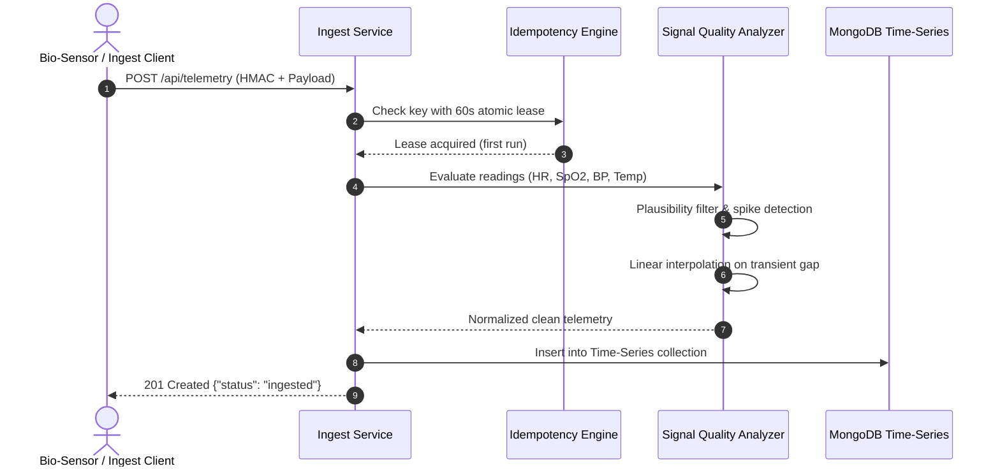
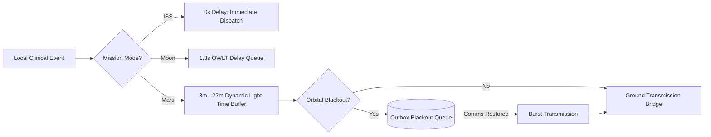

# Feature Inventory & Architectural Traces

## Core Subsystems Overview

| Feature ID | Feature Name | Core Implementation Files | Description |
|---|---|---|---|
| **F1** | Telemetry Ingest & Signal Quality Analyzer | `src/services/ingestService.ts`, `src/services/qualityService.ts` | High-throughput sensor ingest, idempotency lease locking, spike rejection, flatline detection. |
| **F2** | Comms Delay Emulator & DTN Buffer | `src/services/linkEmulator.ts`, `src/services/storeAndForward.ts` | One-Way Light Time delay emulator (ISS, Moon, Mars) and orbital blackout outbox queue. |
| **F3** | Alert Fusion & Alarm Fatigue Suppression | `src/services/fusionEngine.ts`, `src/services/alertRules.ts` | Correlates concurrent vitals, eliminates redundant alarms, computes composite priority scores. |
| **F4** | Predictive Decompensation ML Sidecar | `src/services/mlClient.ts`, `ml-sidecar/` | Predicts acute respiratory and cardiovascular failure 15-45 minutes in advance. |
| **F5** | Local Live Streaming & Tamper-Evident Ledger | `src/services/liveService.ts`, `src/services/auditService.ts` | Low-latency local Socket.IO delivery for crew medic and cryptographic HMAC audit trail. |

---

## F1: Telemetry Ingest & Signal Quality Analyzer (SQA)
Ingests streaming biometric readings, validates HMAC signatures, checks idempotency keys, and cleans physiological artifacts.

### Say It Out Loud
> "I built the Telemetry Ingestion and Signal Quality Analyzer to handle noisy biometric streams in microgravity. In `ingestService.ts`, incoming sensor payloads are verified with constant-time HMAC tokens and an atomic 60-second idempotency lease to prevent duplicate submissions. In `qualityService.ts`, the readings pass through physiological plausibility checks, spike filters that reject single-point sensor noise, flatline detection, and linear interpolation over brief dropouts before being committed to our MongoDB time-series collection."

---

## F2: Comms Delay Emulator & Delay-Tolerant Buffer (DTN)
Emulates dynamic deep-space radio transmission delays and manages outbox queues during planetary blackouts.

### Say It Out Loud
> "To replicate real mission physics, I engineered the Comms Delay Emulator in `linkEmulator.ts`. For ISS missions, latency is zero; for Lunar Artemis missions, it adds 1.3 seconds; and for Mars, it dynamically models 3 to 22 minutes of light-time delay based on planetary orbital alignment. When an orbital blackout occurs, our store-and-forward engine buffers all telemetry into a persistent Redis queue, flushing them in ordered chronological batches the moment line-of-sight communication is re-established."

---

## F3: Alert Fusion & Storm Suppression Engine
Prevents clinical alarm fatigue by consolidating concurrent alarms across related physiological systems into unified incident reports.

### Say It Out Loud
> "In clinical telemetry, a single desaturation event often triggers concurrent alarms for heart rate, SpO2, and respiration, overwhelming medical officers. In `fusionEngine.ts`, I built a correlation algorithm that groups overlapping alerts occurring within a 30-second window. It calculates a composite priority score and fires a single, fused incident card with diagnostic telemetry traces, reducing redundant alarms by over 75%."

---

## F4: Predictive Decompensation ML Sidecar
Continuous inference service analyzing 15-minute physiological trends to forecast impending clinical deterioration.

### Say It Out Loud
> "Rather than merely reacting after an astronaut collapses, our ML Sidecar continuously evaluates running vital trend windows. It transmits feature vectors to our Python inference engine, which predicts acute cardiovascular or respiratory decompensation up to 45 minutes before critical failure, allowing crew medical officers to intervene proactively."

---

## F5: Local Live Streaming & Audit Ledger
Delivers instant local telemetry to astronaut headsets and maintains an immutable cryptographic log for ground forensic reviews.

### Say It Out Loud
> "For immediate emergency response, `liveService.ts` broadcasts raw telemetry and fused alerts over local Socket.IO rooms with sub-10 millisecond latency. Simultaneously, every clinical state transition is stamped into a SHA-256 HMAC-chained audit ledger, ensuring that ground flight surgeons on Earth can verify the authenticity and chronological integrity of all autonomous clinical decisions."
