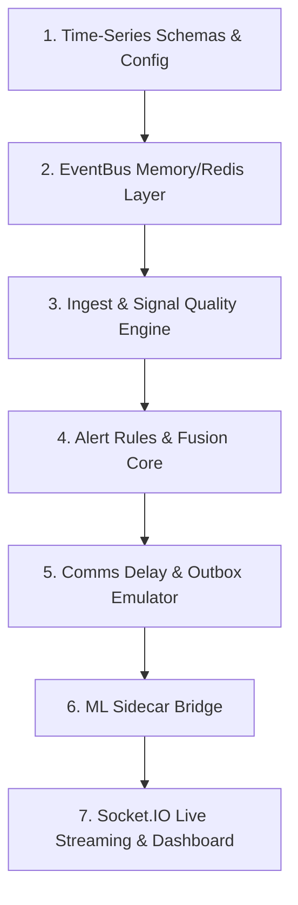

# Build Order: Reconstructing AstroCare

## Step-by-Step Implementation Flow

1. **Schemas & Configuration**: Define MongoDB Time-Series collection schemas for physiological vitals and Zod contract validators.
2. **EventBus Abstraction**: Build `bus/` supporting dual in-memory and Redis Streams backplanes.
3. **Ingest & Quality Filtering**: Implement `ingestService.ts` with atomic idempotency leases and `qualityService.ts` for noise filtering.
4. **Alert Rules & Fusion**: Develop rule engine and multi-vital correlation in `fusionEngine.ts`.
5. **Delay Emulator**: Build `linkEmulator.ts` and blackout queue in `storeAndForward.ts`.
6. **ML Sidecar**: Mount HTTP bridge to Python predictive decompensation model.
7. **Real-Time Gateway**: Expose Socket.IO `/live` and `/ingest` namespaces and connect React dashboard.
