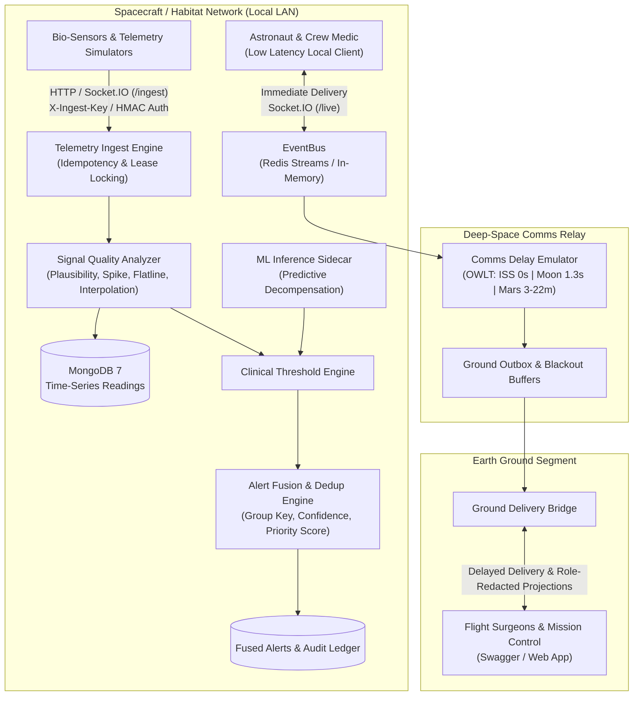

# AstroCare — Space-Medicine Decision-Support Platform

[](https://github.com/nasa-astrocare/astrocare/actions/workflows/ci.yml)
[](https://nodejs.org/)
[](https://www.typescriptlang.org/)
[](LICENSE)

> Autonomous, delay-tolerant clinical decision-support and physiological vital monitoring backend designed for astronaut healthcare across ISS, Lunar (Artemis), and Deep-Space Mars missions under high communication latency (up to 24-minute one-way light time) and orbital blackouts.

---

## 1. System Architecture



---

## 2. Core Capabilities & Subsystems

### A. High-Throughput Telemetry Ingestion (F013 & F019)
- **Machine Authentication:** Supports `X-Ingest-Key` HTTP header and Socket.IO handshake auth validated with constant-time `crypto.timingSafeEqual` SHA-256 digests.
- **Strict Idempotency:** Implements atomic key reservation with 60-second lease takeover, payload hash verification, and `Idempotency-Replayed: true` cache responses.
- **Signal Quality Analysis:** Real-time physiological plausibility screening (HR, SpO2, Systolic/Diastolic BP, Respiration, Core Temp, ECG), spike rejection with 3-reading level shift acceptance, flatline detection, and automatic linear interpolation for short sensor dropouts.

### B. Comms Delay Emulator & Orbital Deliverability (F118)
- **Mission Modes:** Supports `iss` (0s), `moon` (~1.3s), and `mars` (3m to 22m dynamic delay).
- **Asymmetric Delivery:** Immediate real-time broadcast to onboard astronaut interfaces; accurately queued and delayed transmission to Earth-bound ground roles (Flight Surgeons, Mission Control).
- **Orbital Blackout Buffers:** Messages buffered during communication blackouts with deterministic replay upon link re-acquisition.

### C. Alert Fusion, Triage & Inbox Service (F097)
- **Multi-Source Clinical Fusion:** Correlates deterministic sensor threshold breaches with predictive ML inference vectors, resolving into singular, actionable hazard cards.
- **Optimistic Concurrency Control:** Version-checked transitions prevent conflicting clinical decisions between onboard astronauts and Earth-based flight surgeons.
- **Keyset Pagination:** Stable sorting and cursor-based pagination across priority and timestamps without duplicate skips under concurrent updates.
- **Role-Based Privacy Projections:** Full clinical timelines and free-text notes for medical officers and flight surgeons; automatically redacted operational projections for general flight controllers.

### D. Emergency Management (F063)
- **Autonomous Emergency Protocol:** State machine supporting `declared`, `acknowledged`, `resolved`, and `cancelled` states.
- **Safeguards:** 30-second deduplication window and 60-second self-cancellation window for false alarms.

---

## 3. Technology Stack

- **Runtime:** Node.js 20+ LTS (Strict ESM, TypeScript 5)
- **Web & API Framework:** Express 5 with `@asteasolutions/zod-to-openapi` and Swagger UI
- **Database:** MongoDB 7 with Native Time-Series Collections & Mongoose 8
- **Event Bus & Streams:** Redis 7 Streams (`ioredis` 6) with fallback to in-memory event bus
- **Real-Time Transport:** Socket.IO 4 (`/live` and `/ingest` namespaces)
- **Testing & Quality:** Vitest 3, MongoMemoryServer, ESLint, Prettier

---

## 4. Quickstart

### Prerequisites
- Node.js 20+ LTS
- Docker and Docker Compose (recommended) or local MongoDB 7 & Redis 7

### Option 1: Run with Docker Compose (Recommended)

```bash
# Build multi-stage image, start api, mongodb, and redis with healthchecks
docker compose up --build
```

- **Interactive API Documentation:** [http://localhost:4000/docs](http://localhost:4000/docs)
- **OpenAPI 3.0 Specification:** [http://localhost:4000/v1/openapi.json](http://localhost:4000/v1/openapi.json)
- **System Health:** [http://localhost:4000/health](http://localhost:4000/health)
- **Subsystem Readiness:** [http://localhost:4000/v1/health/ready](http://localhost:4000/v1/health/ready)

### Option 2: Local Development

```bash
# 1. Install dependencies
npm --prefix backend install

# 2. Configure environment
cp backend/.env.example backend/.env

# 3. Seed development users
npm --prefix backend run seed:users

# 4. Start local development server (with hot reload)
npm --prefix backend run dev
```

---

## 5. Seeded Accounts & Credentials

The database seeder provisions accounts across all four system roles:

| Role | Email | Password | Access Clearance |
| :--- | :--- | :--- | :--- |
| **Admin** | `admin@astrocare.nasa.gov` | `<CONFIGURED_VIA_ENV>` | Full platform administration & system config |
| **Flight Surgeon** | `surgeon@astrocare.nasa.gov` | `<CONFIGURED_VIA_ENV>` | Full medical triage, clinical notes & alert resolution |
| **Mission Control** | `control@astrocare.nasa.gov` | `<CONFIGURED_VIA_ENV>` | Operational flight status (clinical notes redacted) |
| **Astronaut** | `mercer@astrocare.nasa.gov` | `<CONFIGURED_VIA_ENV>` | Self-telemetry viewing & emergency declaration |
| **Crew Medical Officer** | `chen@astrocare.nasa.gov` | `<CONFIGURED_VIA_ENV>` | Onboard astronaut with delegated medical triage rights |

---

## 6. Testing & Quality Verification

Run all test suites and static analysis tools locally:

```bash
# Run complete unit & integration test suite (300+ tests)
npm --prefix backend test

# Run Redis stream integration tests (requires Redis)
npm --prefix backend run test:redis

# Run ESLint validation (0 errors, 0 warnings enforced)
npm --prefix backend run lint

# Run Python digital-twin simulator tests
cd simulator && python -m pytest

# Run Python digital-twin simulator CLI
cd simulator && python -m src.cli --scenario normal_day --duration 60 --dry-run
```

---

## 7. Physiological Digital-Twin Simulator (`/simulator`)

The platform includes a dedicated, Python-based physiological digital-twin engine located in [`/simulator`](simulator/README.md). It models continuous astronaut biometrics across deep-space missions:

- **Circadian Cycle**: 24-hour diurnal rhythm governing core temperature, heart rate nadir, and nocturnal blood pressure dipping.
- **Exercise Response**: Dynamic first-order exponential kinetics ($\tau_{on}=30\text{s}, \tau_{off}=65\text{s}$) modeling exertion, SBP elevation, and metabolic heat.
- **Microgravity Adaptation**: Cephalad fluid shift (days 0-5) and chronic cardiovascular deconditioning (days 5-180+) with compensatory resting HR elevation.
- **Cabin Environmental Factors**: Hypercapnia and central chemoreceptor-driven tachypnea resulting from elevated CO2.
- **Radiation Accrual**: Interplanetary GCR background tracking and acute solar particle event (SPE) alarms.
- **Sensor Noise & Artifacts**: Motion-coupled Gaussian noise, single-reading rate-of-change spikes, and sensor dropouts (`null`).
- **Scripted YAML Scenarios**: [`normal_day`](simulator/scenarios/normal_day.yaml), [`heavy_exercise`](simulator/scenarios/heavy_exercise.yaml), [`co2_rise`](simulator/scenarios/co2_rise.yaml), [`sensor_dropout`](simulator/scenarios/sensor_dropout.yaml), [`spike_artifacts`](simulator/scenarios/spike_artifacts.yaml), [`cardiac_event_during_blackout`](simulator/scenarios/cardiac_event_during_blackout.yaml), and [`slow_degradation_over_days`](simulator/scenarios/slow_degradation_over_days.yaml).

---

## 8. Unified API & Error Contract

All non-2xx responses strictly conform to the unified error contract:

```json
{
  "error": {
    "code": "VALIDATION_ERROR",
    "message": "Request validation failed",
    "request_id": "c1f7214e-6e4d-4b92-b43f-859424f0c4bb",
    "details": [
      {
        "field": "body.spo2",
        "issue": "must be between 0 and 100"
      }
    ]
  }
}
```

Every response header includes `X-Request-ID` matching the payload `request_id` for end-to-end distributed tracing.
