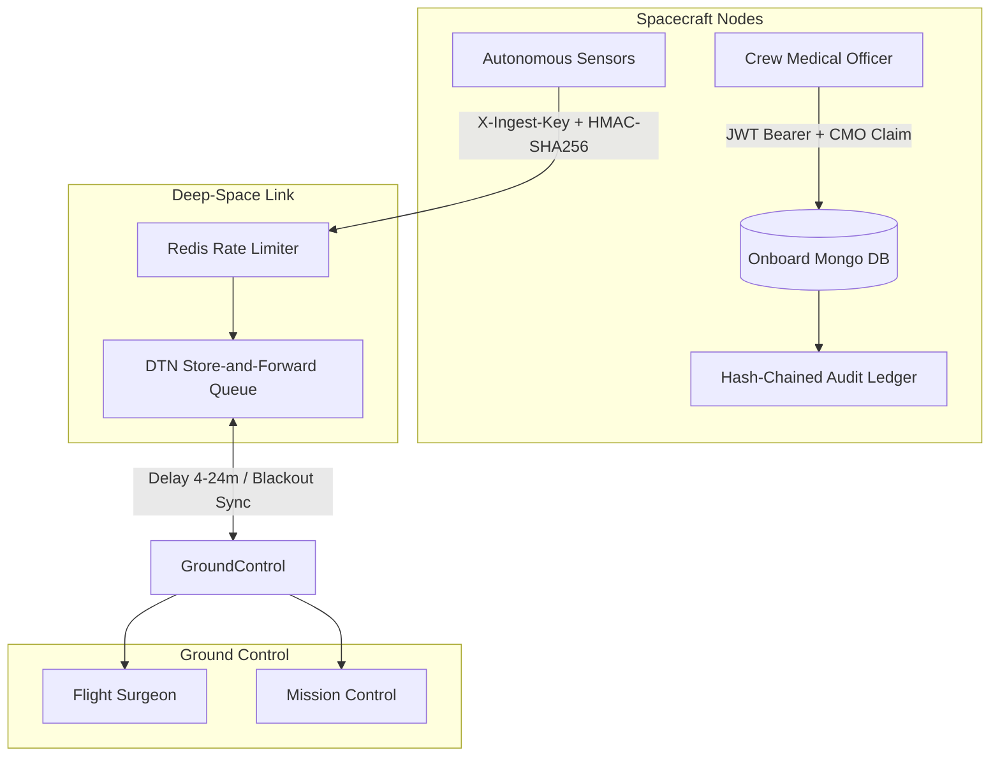

# AstroCare Security Architecture & Integrity Assurance

This document defines the security architecture, threat model, compliance verification against the **OWASP Application Security Verification Standard (ASVS) v4.0**, and automated attack test procedures for the AstroCare deep-space telemedicine backend.

---

## 1. Executive Summary & Security Philosophy

AstroCare operates under unique deep-space operational constraints:
1. **Asymmetric Communication Delays**: Propagation delays from ~0 seconds (ISS) to 1.3 seconds (Moon) and 4–24 minutes (Mars).
2. **Periodic Blackout Windows**: Complete RF severance during planetary orbital occultation and solar conjunctions.
3. **Life-Critical Autonomy**: Crew Medical Officers must perform emergency clinical workflows without real-time Earth reachback.
4. **Zero-Trust Distributed Fabric**: Machine sensors, ground controllers, and spacecraft nodes communicate over untrusted channels where every payload must be authenticated, verified, and accounted for.

To address these constraints, AstroCare implements **Defense in Depth**:
- **Identity & Transport**: Cryptographic JWT authentication, HttpOnly SameSite Secure cookie rotation, and TLS.
- **Cryptographic Ledger**: Tamper-evident, hash-chained audit logging where each record cryptographically anchors the entire preceding log history.
- **Distributed Bandwidth Protection**: Redis-backed rate limiting preserving standardized `429 RATE_LIMITED` contracts and `Retry-After` headers.
- **Data Authenticity**: Optional HMAC-SHA256 payload signing for machine ingest clients (e.g. autonomous digital-twin simulators).

---

## 2. Deep-Space Threat Model (STRIDE Methodology)

### System Assets

| Asset | Sensitivity | Impact of Compromise |
|---|---|---|
| **Crew Vital Telemetry** | High (PHI / Life-Safety) | Spoofed vitals can induce incorrect medical interventions or mask acute hypoxia/cardiac events. |
| **Clinical Decision Logs** | Critical (Life-Safety) | Tampered autonomous treatment records risk fatal drug interactions or incorrect post-blackout care. |
| **Prescription & Protocol Catalog** | Critical (Life-Safety) | Unauthorized modification of drug dosages or clinical workflows directly threatens astronaut survival. |
| **Audit Ledger** | High (Integrity / Compliance)| Undetected log mutation prevents flight surgeons from reconstructing emergency events. |
| **Mission Clock & Ephemeris** | Moderate (Operational) | Altered time coordinates disrupt orbital blackout predictions and telemetry time-series indexing. |

---

### STRIDE Threat Classification & Mitigations



#### 1. Spoofing (Identity Deception)
- **Threat**: An adversary on the spacecraft LAN or untrusted network node submits fabricated physiological telemetry or impersonates ground controllers.
- **Mitigations**:
  - Machine clients authenticate using high-entropy API keys (`X-Ingest-Key`) validated using timing-safe buffer comparison (`crypto.timingSafeEqual`) to prevent side-channel timing attacks.
  - Telemetry batches support optional **HMAC-SHA256 payload signing** (`X-Telemetry-Signature`), verified before parsing or database persistence.
  - Interactive users authenticate via JSON Web Tokens (JWT) signed with 32+ character secrets (`HS256` or `RS256`). Tokens unsigned or using algorithm `none` are strictly rejected.

#### 2. Tampering (Data Modification)
- **Threat**: Malicious insiders or compromised software alter vital history, clinical notes, or emergency actions taken during a blackout.
- **Mitigations**:
  - **Hash-Chained Audit Ledger**: Every audit entry stores a monotonic `sequence_number`, the previous block's SHA-256 hash (`prev_hash`), and a deterministic SHA-256 digest of its canonical fields (`hash`). Any post-facto mutation breaks the chain and is detected by `verifyAuditLedger()`.
  - Telemetry batches use payload SHA-256 hashing (`computePayloadHash`) tied to atomic idempotency reservations (`MongoIdempotencyStore`). Conflicting payloads resubmitted with identical keys are rejected with `409 CONFLICT`.

#### 3. Repudiation (Denial of Action)
- **Threat**: A crew member denies administering an emergency medication or completing an autonomous checklist step during a comms blackout.
- **Mitigations**:
  - Emergency protocol completions record an immutable `AutonomousDecisionLog` containing the actor ID, target crew member, actions taken, exact medication dosages, and a cryptographic snapshot of the comms `link_state` at the second of decision.
  - Once link connectivity is restored, decisions are synced to Earth with `onboard_wins` precedence and require formal Flight Surgeon sign-off (`POST /v1/protocols/decisions/reconcile`).

#### 4. Information Disclosure (Confidentiality Breach)
- **Threat**: Sensitive astronaut medical notes or psychological evaluations are leaked to unauthorized mission specialists or ground operators.
- **Mitigations**:
  - **Role-Based Projection**: `FlightSurgeon` users receive full clinical observations, differential diagnoses, and medication logs (`GET /v1/inbox`). Non-medical roles (`mission_control`, `astronaut`) receive sanitized alerts with medical notes redacted.
  - Cross-crew telemetry access is strictly blocked: astronauts can only submit and query telemetry for their own linked crew profile.

#### 5. Denial of Service (Availability Loss)
- **Threat**: Telemetry storms, buggy client loops, or malicious password guessing exhaust spacecraft CPU and saturation-limited deep-space link bandwidth.
- **Mitigations**:
  - **Redis-Backed Distributed Rate Limiting**: Token-bucket / sliding-window counters protect `/v1` routes. When limits are exceeded, requests are rejected with standardized HTTP `429` and machine-readable `Retry-After: <seconds>`.
  - **Brute-Force Account Lockout**: After 5 consecutive failed login attempts, user accounts are locked for 15 minutes (`locked_until`).
  - **Payload Size Caps**: Body parsers enforce a strict `1MB` maximum body size, and telemetry batches reject arrays exceeding `500` readings.

#### 6. Elevation of Privilege (Authorization Bypass)
- **Threat**: A regular astronaut user accesses administrative endpoints, alters feature flags, or grants themselves Crew Medical Officer status.
- **Mitigations**:
  - Role-based access control middleware (`requireRole`) checks decoded JWT claims on every protected route.
  - Medical designations are restricted: only astronauts can be designated as Crew Medical Officers, and the operation requires explicit administrative authorization (`PUT /v1/users/:id/medical-officer`).

---

## 3. OWASP ASVS v4.0 Compliance Checklist

| ASVS Section | Level | Status | Implemented Controls |
|---|:---:|:---:|---|
| **V1: Architecture, Design and Threat Modeling** | L2/L3 | **COMPLIANT** | Formal STRIDE threat model documented; centralized error handling without stack leakage; strict separation between ground and spacecraft execution domains. |
| **V2: Authentication** | L2/L3 | **COMPLIANT** | Argon2/Bcrypt password hashing (rounds: 12); length-safe timing-safe comparisons; account lockout after 5 failed attempts; token revocation lists. |
| **V3: Session Management** | L2 | **COMPLIANT** | Stateless short-lived JWT access tokens (15m TTL); rotating refresh tokens stored in `HttpOnly`, `SameSite=Lax`, `Secure` cookies; automated token family revocation upon reuse detection. |
| **V4: Access Control** | L2/L3 | **COMPLIANT** | Role-based access control (`admin`, `flight_surgeon`, `mission_control`, `astronaut`); Crew Medical Officer attribute checks; IDOR prevention across crew profiles. |
| **V5: Validation & Sanitization** | L2 | **COMPLIANT** | Zod input schemas with OpenAPI 3.1 validation for all request bodies, params, and queries; 1MB HTTP payload ceiling; array limit of 500 items. |
| **V6: Stored Cryptography** | L2/L3 | **COMPLIANT** | SHA-256 hash-chained audit ledger; SHA-256 token hashing; canonical JSON serialization preventing key-ordering discrepancies. |
| **V7: Error Handling & Logging** | L2 | **COMPLIANT** | Unified error format (`code`, `message`, `request_id`, `details`); internal exceptions masked to generic `INTERNAL_ERROR` 500; structured Pino logging with credential redaction. |
| **V8: Data Protection** | L2 | **COMPLIANT** | Role-based medical redaction for non-clinical staff; field-level exclusion of passwords and secret hashes in JSON transforms. |
| **V9: Communication Security** | L2 | **COMPLIANT** | TLS transport encryption; DTN store-and-forward architecture with delay-tolerant idempotency and packet-loss resilience. |
| **V13: API & Web Services** | L2/L3 | **COMPLIANT** | RESTful `/v1` endpoints documented with OpenAPI 3.1; rate limiting with `Retry-After`; `X-Request-ID` tracing on every request/response. |

---

## 4. Self-Run Attack Test Suite (`tests/security.attacks.test.ts`)

A dedicated automated attack simulation suite verifies that every documented attack vector is reliably detected, logged, and rejected.

### Attack Scenarios Tested

```text
 ✓ Phase 5 — Security & Integrity Attack Test Suite (17 tests passed)
   ├── 1. Authentication Bypass Resistance
   │   ├── rejects unauthenticated requests to protected endpoints with 401 UNAUTHENTICATED
   │   └── rejects malformed Bearer authorization headers with 401 UNAUTHENTICATED
   ├── 2. JWT Tampering & Algorithm Insecurity
   │   ├── rejects tokens signed with an unauthorized external key
   │   ├── rejects algorithm "none" unsigned token attacks
   │   └── rejects signature truncation and byte flipping tampering
   ├── 3. Insecure Direct Object Reference (IDOR) Across Crew
   │   └── forbids an astronaut from submitting telemetry for another crew profile (403 FORBIDDEN)
   ├── 4. Refresh Token Replay & Family Revocation
   │   └── revokes the entire token family when a refresh token replay is detected
   ├── 5. Oversized Payload & DoS Mitigation
   │   ├── rejects HTTP request bodies exceeding the 1MB payload limit (400 BAD_REQUEST)
   │   └── rejects telemetry batches with more than 500 readings (422 VALIDATION_ERROR)
   ├── 6. Injection Attack Neutralization
   │   ├── rejects NoSQL query operator injection in request bodies (422 VALIDATION_ERROR)
   │   └── neutralizes HTML and script tags in user metadata fields without execution
   ├── 7. Hash-Chained Audit Ledger Tampering Detection
   │   ├── detects record modification and breaks in the cryptographic hash chain
   │   └── detects deleted block sequence gaps in the ledger
   ├── 8. Distributed Rate Limiting & 429 Contract
   │   └── throttles rapid burst requests, returns 429 RATE_LIMITED, and sets Retry-After header
   └── 9. HMAC Telemetry Batch Signing
       ├── accepts telemetry with valid HMAC-SHA256 signature from machine client
       ├── rejects telemetry with invalid or tampered HMAC signature (401 UNAUTHENTICATED)
       └── rejects unsigned telemetry when telemetry_hmac_required is enabled (401 UNAUTHENTICATED)
```

---

## 5. Verification & Operator Runbook

### Running the Attack Test Suite
To execute the automated security attack test suite:
```bash
# In /backend
npm test tests/security.attacks.test.ts
```

### Verifying Audit Ledger Integrity via CLI
A standalone CLI tool allows mission controllers or spacecraft automated jobs to verify that the cryptographic audit ledger has not been tampered with:
```bash
# In /backend
npm run audit:verify
```
**Sample Successful Output:**
```json
{"level":30,"time":"2026-10-25T01:31:00.000Z","msg":"✅ Audit ledger integrity verification PASSED: All blocks contiguous and untampered.","total_records":42,"verified_count":42,"genesis_hash":"0000000000000000000000000000000000000000000000000000000000000000","latest_hash":"a1b2c3d4..."}
```
If tampering is detected, the CLI logs the exact sequence number that was mutated and exits with non-zero exit code `1`.

### Verifying Audit Ledger Integrity via API
Flight Surgeons and Administrators can query the verification state over REST:
```bash
curl -X GET http://localhost:4000/v1/audit/verify \
  -H "Authorization: Bearer <flight_surgeon_jwt>"
```
**Response Format (200 OK):**
```json
{
  "valid": true,
  "verified_count": 42,
  "total_records": 42,
  "genesis_hash": "0000000000000000000000000000000000000000000000000000000000000000",
  "latest_hash": "6b2a0c44..."
}
```
If tampered:
```json
{
  "valid": false,
  "verified_count": 14,
  "total_records": 42,
  "broken_at_sequence": 15,
  "broken_record_id": "67b34120...",
  "reason": "HASH_MISMATCH",
  "details": {
    "expected_hash": "5d2e...",
    "recorded_hash": "8f3b..."
  }
}
```
