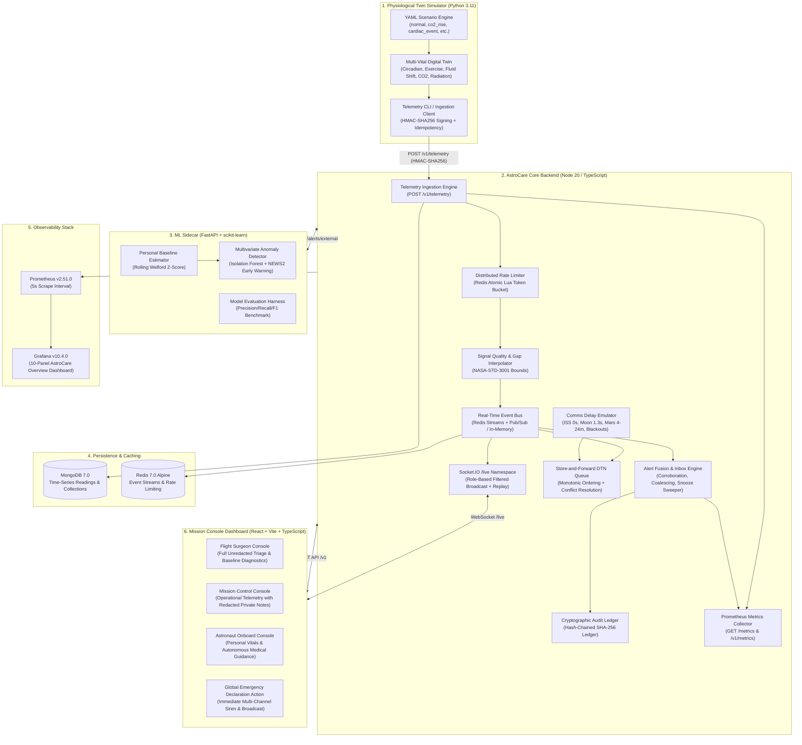

# AstroCare System Architecture & Technical Specification

## 1. System Overview

**AstroCare** is an autonomous space-medicine decision support system designed to monitor astronaut physiological health under deep-space communication constraints (ISS LEO, Lunar Gateway, and Mars surface transit). 

Due to the finite speed of light, one-way propagation delays to Mars range from **4 to 24 minutes** (8 to 48 minutes round-trip), punctuated by planetary radio blackouts (such as solar conjunctions lasting up to two weeks). Under these conditions, real-time telemedicine from Earth is physically impossible. AstroCare operates as an autonomous edge-first medical platform that continuously ingests biometric streams, detects multi-vital clinical anomalies via scikit-learn machine learning, performs alert fusion and de-duplication, provides store-and-forward delay-tolerant synchronization, and exposes autonomous medical guidance protocols to crew medical officers.

---

## 2. Complete Architecture Diagram

---

## 3. Subsystem Breakdown

### 3.1 Physiological Digital-Twin Simulator (`/simulator`)
- **Engine**: Python 3.11 with NumPy and PyYAML.
- **Biometric Model**: Simulates 8 concurrent vital signs (heart rate, SpO2, systolic/diastolic BP, respiration rate, core temperature, cabin CO2, cumulative radiation dose, and HRV RMSSD).
- **Physiological Factors**:
  - *Circadian cycle*: Sinusoidal diurnal variations (~24-hour cycle).
  - *Exercise stress*: Aerobic and anaerobic cardiovascular responses.
  - *Microgravity fluid shift*: Cephalad fluid redistribution impacting central venous pressure and baseline blood pressure.
  - *Cardiovascular deconditioning*: Progressive loss of baroreflex sensitivity across mission duration.
  - *Environmental CO2 & SPE radiation*: Cabin ambient CO2 elevation causing hypercapnia, and solar proton event radiation exposure.
- **Security & Integrity**: Telemetry batches are signed with HMAC-SHA256 headers (`X-Telemetry-Signature`) and indexed with idempotent UUIDs.

### 3.2 Machine Learning Sidecar (`/ml-sidecar`)
- **Framework**: Python 3.11 with FastAPI, scikit-learn, and NumPy.
- **Multivariate Anomaly Detection**: Combines individual rolling z-score baseline comparisons with an un-supervised **Isolation Forest** classifier trained on nominal microgravity flight profiles.
- **NEWS2 Clinical Early-Warning Score**: Implements multi-vital risk scoring tailored for microgravity, computing explanation factors for each vital sign's contribution to the alert.
- **REST Contract**: Dispatches alerts to backend `POST /v1/alerts/external` authenticated with `X-ML-Key`.

### 3.3 Core Backend & Alert Fusion (`/backend`)
- **Technology**: Node.js 20+, TypeScript (strict ESM), Express 5, Mongoose 8, ioredis 6, Socket.IO 4.
- **Ingestion Pipeline**: Validates incoming vital arrays against strict Zod schemas, assigns monotonic timestamps, checks cryptographic HMACs, and executes bulk writes into MongoDB time-series collections.
- **Alert Fusion**: Deduplicates overlapping alerts across rule-based clinical thresholds and ML anomaly detectors into unified Fused Alert cards. Manages workflow states (`open`, `acknowledged`, `snoozed`, `resolved`) and runs an autonomous `SnoozeSweeper` to re-escalate unaddressed risks.
- **Comms Delay & DTN Store-and-Forward**: Emulates orbital speed-of-light delays (ISS $\sim$0s, Moon $\sim$1.3s, Mars 4–24m). In blackout, messages queue safely in MongoDB and re-synchronize monotonically upon reconnection using an `onboard_wins` strategy for life-safety actions.
- **Cryptographic Audit Ledger**: Every security, emergency, and clinical action is committed to a SHA-256 hash-chained immutable ledger. The `/v1/audit/verify` endpoint dynamically verifies chain linkage.

### 3.4 Mission Console Dashboard (`/dashboard`)
- **Technology**: React 18, Vite 5, TypeScript.
- **Styling**: Vanilla CSS glassmorphic dark space-flight design system with Orbitron, Inter, and JetBrains Mono typography.
- **Real-Time WebSocket Link**: Socket.IO client connected to `/live` with auto-reconnection and historical buffer replay.
- **Role-Based Medical Privacy (NASA-STD-3001)**:
  - `flight_surgeon`: Full unredacted access to medical histories, clinical notes, and snooze triage.
  - `mission_control`: Operational telemetry visibility with confidential medical notes automatically redacted (`[REDACTED MEDICAL CONFIDENTIAL]`).
  - `astronaut`: Focused view of personal biometrics, autonomous clinical guidance checklists, and emergency declaration button.

---

## 4. Physiological Bounds & Clinical Reference Standards

| Metric | Nominal Range | Warning (Amber) | Critical (Red) | Clinical Reference Standard |
| :--- | :--- | :--- | :--- | :--- |
| **Heart Rate** | 60 – 100 bpm | 100 – 130 bpm / 50 – 59 bpm | $>130$ bpm / $<45$ bpm | NASA-STD-3001 Vol 1; AHA ACLS Guidelines |
| **Oxygen Saturation (SpO2)** | $\ge 95\%$ | $90 - 94\%$ | $< 90\%$ (Hypoxia) | NASA-STD-3001 Table 6.3-1; Acute Hypoxia Threshold |
| **Systolic BP** | 90 – 120 mmHg | 120 – 140 mmHg | $>160$ mmHg / $<85$ mmHg | NASA HRP Evidence Report on Cardiovascular Deconditioning |
| **Diastolic BP** | 60 – 80 mmHg | 80 – 90 mmHg | $>100$ mmHg / $<50$ mmHg | NASA HRP Evidence Report on Cardiovascular Deconditioning |
| **Respiration Rate** | 12 – 20 br/min | 20 – 26 br/min | $>26$ br/min / $<8$ br/min | Royal College of Physicians NEWS2 Standard |
| **Core Temperature** | 36.5 – 37.5 °C | 37.5 – 38.3 °C | $>38.5$ °C (Hyperthermia) / $<35.0$ °C | NASA-STD-3001 Thermal Environment Standards |
| **Cabin Ambient CO2** | $< 3.0$ mmHg | 3.0 – 5.0 mmHg | $> 5.0$ mmHg (Hypercapnia) | NASA-STD-3001 Vol 2, Sec 6.2; Law et al. (2014) |
| **Career Radiation** | $< 600$ mSv | 400 – 600 mSv | $> 600$ mSv (Career Limit) | NASA Radiation Health Standards (2021 update) |
